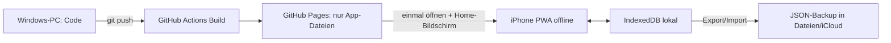

# Gym-Tracker – Projektplan (schlanke Variante)

Leitprinzip: **so wenige Abhängigkeiten, so wenige Tabellen und so wenige Screens wie möglich.**
Ziel ist ein Bundle unter 50 KB gzip, ohne Körperkarte.

## 1. Technik

| Bereich | Wahl | Warum schlank |
|---|---|---|
| Build | Vite + TypeScript | Kein Laufzeit-Overhead |
| UI | **Preact** (React-API, ~4 KB) statt React (~45 KB) | Gleicher JSX-/Hooks-Code. Wechsel zu React wäre nur ein Alias in der Config |
| Routing | Eigener Mini-Hash-Router (~20 Zeilen, `location.hash`) | Keine Abhängigkeit, funktioniert auf GitHub Pages |
| Styling | Eine Datei mit Plain CSS und CSS-Variablen (Dark Mode) | Kein Tailwind, kein PostCSS |
| Speicher | IndexedDB via **`idb`** (~1 KB) | Statt Dexie (~30 KB). Nur 4 Stores mit dokumentartigen Objekten |
| Offline | `vite-plugin-pwa` (nur zur Build-Zeit) | Erzeugt Service Worker + Manifest |
| Diagramme | **Eigene SVG-Linien-Charts** (~100 Zeilen) | Statt Recharts (~100 KB) |
| Körperkarte | Inline-SVG, per Lazy-Import nachgeladen | Belastet den Start nicht |
| Hosting | GitHub Pages via GitHub Actions | Nur statische Dateien |
| Backup | JSON-Export/-Import | Web Share API bzw. Download |

Laufzeit-Abhängigkeiten: **`preact`, `idb`**, sonst keine.



## 2. Datenmodell – 4 Stores, verschachtelte Dokumente

```ts
type Equipment = 'KH' | 'LH' | 'SZ' | 'Kabel' | 'Maschine' | 'Koerper';

// Store: exercises – globaler Katalog, gilt planübergreifend
interface Exercise {
  id: string; name: string; equipment: Equipment;
  muscles: string[];        // erste = primär, z. B. ['brust','trizeps']
  note?: string;            // allgemeine Notiz: "Schultern unten lassen"
  setting?: string;         // Geräteeinstellung: "(5;2)"
}

// Store: plans – Tage und Übungen eingebettet
interface Plan {
  id: string; name: string; split: string;   // "3er PPL", "2,5er" …
  start: string; weeks: number; active: boolean;
  days: { id: string; name: string; items: PlanItem[] }[];
}
interface PlanItem {
  exerciseId: string; sets: number; repMin: number; repMax: number;
  weight?: number; scheme?: string;  // Sonderfall "10/10/10" (L-Sit)
  hint?: string;                     // Hinweis fürs nächste Mal: "++", "Zughilfe"
  altId?: string;                    // Alternative: Wadenmaschine
  superset?: boolean;
}

// Store: sessions – Sätze eingebettet
interface Session {
  id: string; planId: string; dayId: string; date: string;
  locker?: string;                    // Spindnummer
  note?: string;
  log: { exerciseId: string; sets: { w: number; r: number }[]; note?: string }[];
}

// Store: settings (ein Datensatz): Schrittweiten je Equipment, aktuelle Spindnummer
```

Indizes: `sessions` nach `date` und `planId`. Die Historie einer Übung entsteht durch einmaliges Durchsuchen der Sessions. Das reicht bei einigen hundert Sessions problemlos.

## 3. Kernlogik (ein Modul `logic.ts`, reine Funktionen, testbar)

1. **Nächster Tag**: Der Tag des aktiven Plans mit dem ältesten letzten Trainingsdatum.
2. **Hinweis fürs nächste Mal**
   - Alle Sätze ≥ `repMax` → „+Schrittweite“ (LH 2,5 / KH 2 / Kabel 1,25 / Maschine 5, einstellbar).
   - Ein Satz < `repMin` → „Gewicht halten“.
   - Zusätzlich werden der manuelle `hint` und die allgemeine Notiz angezeigt.
3. **Vorschlag für einen neuen Plan**: Letzte Sätze der Übung → 1RM nach Epley `w*(1+r/30)` → zurückgerechnet auf die Mitte des Ziel-Wiederholungsbereichs → auf die Schrittweite gerundet. Angezeigt mit Datum des letzten Trainings.
4. **Fortschritt**: Pro Session der Maximalwert von Gewicht, Wiederholungen und geschätztem 1RM als Datenpunkte für das SVG-Chart.

## 4. Screens (5)

- **Start** (`#/`): großer Button für den nächsten Tag, Liste der Tage mit letztem Datum, aktuelle Spindnummer
- **Training** (`#/s/:id`): Spind-Eingabe oben. Übungskarten mit „Letztes Mal“, Hinweis und Notiz. Satzfelder sind vorbelegt, Anpassung mit +/−
- **Pläne** (`#/plans`): Plan, Tage und Übungen in einem Editor. Übungen werden über eine Suche ausgewählt oder direkt neu angelegt, mit Gewichtsvorschlag
- **Fortschritt** (`#/stats`): Übung auswählen → Chart. Später ein Tab für die Körperkarte
- **Einstellungen** (`#/settings`): Export/Import, Schrittweiten, Persistenz-Status

Ein separater Übungskatalog-Screen entfällt: Übungen werden inline im Plan-Editor angelegt und bearbeitet.

## 5. Dateistruktur

```
src/
  main.tsx  router.ts  db.ts  logic.ts  styles.css
  screens/  Home.tsx Session.tsx Plans.tsx Stats.tsx Settings.tsx
  components/  LineChart.tsx  BodyMap.tsx (lazy)
public/  icons, apple-touch-icon.png
.github/workflows/deploy.yml
```

## 6. Phasen

- **MVP**: Setup, PWA, db, Plan-Editor, Training, Start, Hinweise, Backup, Deployment
- **Phase 2**: Charts, Gewichtsvorschlag für neue Pläne
- **Phase 3**: Körperkarte (lazy), optional Text-Import der bisherigen Notizen
